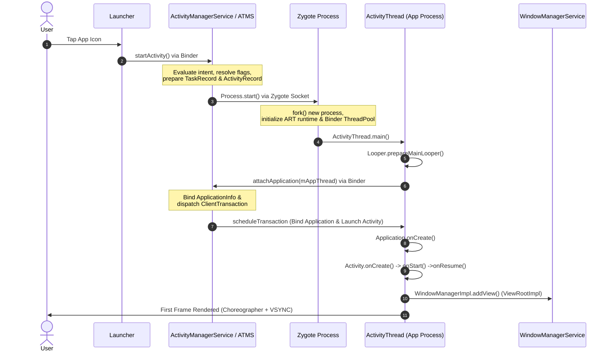

## 1. Architectural Context & Design Goals

A **Cold Start** occurs when an application is launched from scratch: no existing process, `ActivityThread`, or loaded classes exist in memory. 
* **Design Challenge**: Minimize startup latency while ensuring memory safety and isolation across multi-tenant applications.
* **Core Mechanisms Involved**: 
  * **Binder IPC**: Inter-process communication between `Launcher`, `ActivityManagerService` (AMS), and the target app process.
  * **Zygote Socket & CoW**: Fast process instantiation via `fork()` utilizing Linux Copy-on-Write (CoW) memory sharing.
  * **Frame Pipeline**: `Choreographer` and `RenderThread` coordination for initial UI layout and rendering pass.

---

## 2. End-to-End Sequence & Process Flow



---

## 3. Execution Phases Breakdown

### Phase 1: Request & Process Decision (Launcher ➔ AMS)

1. User taps the application icon on the Home screen (`Launcher`).
2. `Launcher` delegates the intent to `ActivityManagerService` / `ActivityTaskManagerService` (ATMS) via Binder.
3. AMS checks if the target process exists in the `ProcessList`. If not, it initiates the **Cold Start** pipeline.

### Phase 2: Process Instantiation (AMS ➔ Zygote Socket)

1. AMS communicates with the pre-initialized **`Zygote`** process via a local Unix Domain Socket (`/dev/socket/zygote`).
2. `Zygote` executes `fork()` to spawn a new process, inheriting pre-loaded system classes, resources, and the ART runtime (saving memory via Linux Copy-on-Write).
3. The child process sets up its UID/GID, initializes its Binder threadpool (`ProcessState::self()->startThreadPool()`), and jumps to `ActivityThread.main()`.

### Phase 3: Application & Activity Initialization (`ActivityThread`)

1. `ActivityThread.main()` creates the main event loop (`Looper.prepareMainLooper()`) and calls back to AMS via `attachApplication()`.
2. AMS sends back a `ClientTransaction` containing the `ApplicationInfo` and initial `Activity` launch requests.
3. `ActivityThread` executes:
* **Application Instantiation**: Creates `LoadedApk`, builds `ContextImpl`, instantiates `Application`, and triggers `Application.onCreate()`.
* **Activity Creation**: Instantiates target `Activity`, attaches its `Context`, performs `Activity.onCreate()`, `onStart()`, and `onResume()`.


### Phase 4: UI Pipeline & First Frame Rendering

1. During `onResume()`, `WindowManagerImpl.addView()` creates a `ViewRootImpl` instance.
2. `ViewRootImpl` connects to **WindowManagerService (WMS)** and registers for VSYNC signals via `Choreographer`.
3. Upon receiving VSYNC, `ViewRootImpl` triggers the `performTraversals()` pass (`measure` -> `layout` -> `draw`), delegating drawing commands to `RenderThread` and `SurfaceFlinger` for final screen display.

---

## 4. Key Performance Bottlenecks & System Mitigations

| Stage | Potential Bottleneck | Framework Mitigation / Best Practices |
| --- | --- | --- |
| **Process Forking** | Heavy class loading or JIT compilation. | Pre-loaded classes/resources in `Zygote` (CoW memory sharing). |
| **Application Launch** | Heavy I/O or blocking operations in `Application.onCreate()`. | Defer non-critical initializations via `IdleHandler` or background threads. |
| **First Frame Render** | Deep View hierarchy or complex layout inflation. | Flatten layout structures, leverage AsyncLayoutInflater, defer view stubs. |

```

