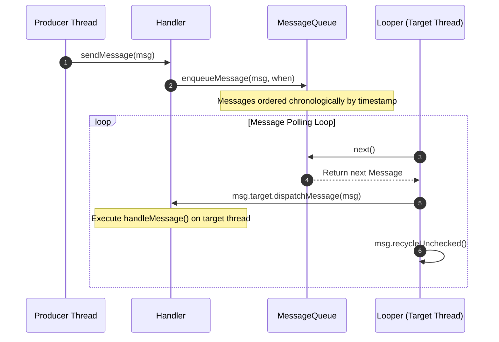
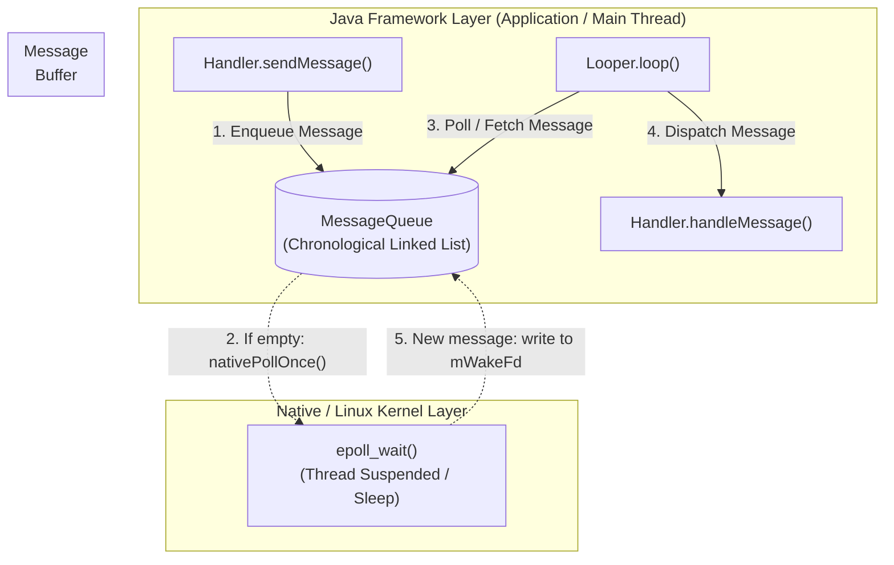

This document explores the internal design and implementation of Android's asynchronous message-passing framework, tracing from the Java framework layer down to the Linux native poll mechanism.

## 1. Core Components Overview

Before diving into how the components collaborate, let's break down the roles and responsibilities of the four key members in the Handler ecosystem:

- **`Message` (The Data)**:
    - The carrier of data (`what`, `arg1`, `arg2`, `obj`). Crucially, it also acts as a **singly linked list node** (via its `next` pointer) to link messages together within the queue.
- **`MessageQueue` (The Buffer)**:
    - The message queue container. It manages and orders messages chronologically based on their execution timestamp (`when`), providing core operations like `enqueueMessage()` and `next()`.
- **`Looper` (The Engine)**:
    - The driver of the message loop. It maintains a reference to a `MessageQueue` and runs an infinite loop (`Looper.loop()`) to poll for upcoming messages. A single thread is bound to one `Looper` via `ThreadLocal`.
- **`Handler` (The Interface)**:
    - The producer and consumer of messages. Developers use it to push messages into the queue (`sendMessage()` / `post()`), and once a message is polled by the Looper, it is dispatched back to the Handler's `handleMessage()` callback on the target thread.

## 2. Workflow & Collaboration: How They Work Together

The Handler mechanism establishes a robust inter-thread communication loop through the following sequential stages:

1. **Production Stage**: Any thread can use a specific thread's `Handler` to send a `Message`. The `Handler` safely routes the message into the corresponding thread's `MessageQueue`.
2. **Polling & Consumption Stage**: The target thread's `Looper.loop()` executes an infinite loop, invoking `MessageQueue.next()` to fetch the next pending message.
3. **Dispatch & Execution Stage**: Once a message is retrieved, the Looper invokes `msg.target.dispatchMessage(msg)` (where `target` is the original Handler), callback-dispatching the execution logic onto the target thread.

## 3. Deep Dive: Architectural Design & Implementation

### 3.1 The Native Epoll Mechanism (How the Main Thread Avoids Blocking)

A common question regarding performance is: *How does an infinite loop in `Looper.loop()` prevent the main thread from freezing the application (ANR)?*

- When `MessageQueue.next()` is called and no messages are available, the framework avoids CPU-wasting busy-waiting by invoking a native method (`nativePollOnce()`).
- In the C++ implementation (`android_os_MessageQueue.cpp`), it leverages the Linux **`epoll`** mechanism to monitor a file descriptor (`mWakeFd`).
- The thread is suspended in kernel space (sleeping and releasing CPU resources) until another thread enqueues a message, which triggers a write operation to `mWakeFd` and instantly wakes up the loop.

### 3.2 Memory Optimization: Message Pooling

Frequent creation and destruction of `Message` objects can trigger frequent Garbage Collection (GC) pauses and memory jitter.

- `Message` implements a static recycling mechanism utilizing a singly linked object pool (`sPool`), capped at a maximum capacity of 50 items.
- When a message finishes processing, `msg.recycleUnchecked()` clears its state and pushes it back into the pool.
- Developers should prefer `Message.obtain()` over `new Message()` to retrieve pre-allocated instances from the pool, optimizing memory overhead.
